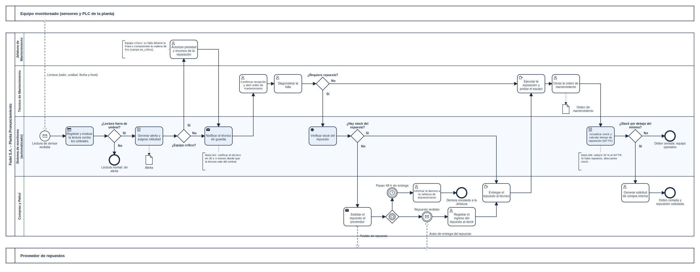

# Módulo de Monitoreo Crítico y Alertas de Mantenimiento Correctivo

**Caso de estudio:** Fadel S.A. – Planta de faena de Pronunciamiento (Entre Ríos)
**Asignatura:** Organización Empresarial – Tecnicatura Universitaria en Programación a Distancia (UTN)
**Trabajo:** TPI – Entrega N.º 4 (Procesos, trabajo colaborativo y control integrador)

| | |
|---|---|
| 📂 Repositorio | https://github.com/TomiGirard/fadel-monitoreo-mantenimiento |
| 📋 Tablero ágil | https://github.com/users/TomiGirard/projects/[N] |

---

## 1. Descripción del sistema

El proyecto propone un **módulo de software web** para la planta de faena de Fadel S.A. que:

1. monitorea los equipos críticos (túnel dinámico, escaldador, calderas, equipos de frío);
2. genera una **alerta automática** cuando una lectura sale de los umbrales definidos;
3. gestiona la **orden de mantenimiento correctivo** que se deriva de la alerta;
4. descuenta del stock el repuesto usado y emite una **solicitud de compra interna** cuando el stock baja del mínimo.

**Objetivo general:** reducir el tiempo muerto de la línea de faena y proteger la cadena de frío (SENASA / BRCGS).
El caso, el análisis sistémico (TGS), el FODA, las metas y el cronograma están en `docs/entregas/`.

## 2. Integrantes

| Integrante | Rol en el proyecto |
|---|---|
| Tomas Agustin Girard | Líder de proyecto y analista funcional (LP) |

Grupo n.º 12 · Docente titular: Prof. Gabriela Martínez · Tutores: Prof. Carolina Bruno, Prof. Mario Raúl López, Prof. Andrea Ramos.

## 3. Proceso de negocio (BPMN)



- Archivo editable: [`bpmn/proceso_mantenimiento_correctivo.bpmn`](bpmn/proceso_mantenimiento_correctivo.bpmn) (se abre en [bpmn.io](https://demo.bpmn.io) o se importa en Bizagi Modeler).
- Vista vectorial: [`bpmn/proceso_mantenimiento_correctivo.svg`](bpmn/proceso_mantenimiento_correctivo.svg).
- **Pools:** Fadel S.A. – Planta Pronunciamiento · Sensores/PLC (externo) · Proveedor de repuestos (externo).
- **Lanes:** Jefatura de Mantenimiento · Técnico de Mantenimiento · Sistema de monitoreo (automatizado) · Compras y Pañol.
- **Compuertas de decisión (excepciones):** ¿Lectura fuera de umbral? · ¿Equipo crítico? · ¿Requiere repuesto? · ¿Hay stock del repuesto? · ¿Stock por debajo del mínimo? · compuerta basada en eventos (repuesto recibido / pasan 48 h).

## 4. Estructura del repositorio

```
.
├── README.md                       ← portada del proyecto
├── bpmn/                           ← diagrama BPMN (.bpmn, .svg, .png)
├── docs/
│   ├── entregas/                   ← Entregas 1 a 3 (PDF)
│   ├── historias-de-usuario.md     ← backlog ágil (3 historias)
│   └── indicadores-de-control.md   ← indicadores y estándares de desempeño
└── .github/pull_request_template.md
```

## 5. Dinámica de trabajo con Git y GitHub

**Ramas**

| Rama | Uso |
|---|---|
| `main` | Versión estable y revisada. No se hace *push* directo: solo se integra por Pull Request. |
| `docs/<tema>` | Documentación (p. ej. `docs/bpmn-proceso`, `docs/indicadores-control`). |
| `feature/<tema>` | Funcionalidades del módulo (a partir del Sprint 1). |
| `fix/<tema>` | Correcciones. |

**Mensajes de commit** (formato `tipo(ámbito): descripción en infinitivo o pasado, clara y concreta`):

- ✅ `docs(bpmn): agregar diagrama del proceso de mantenimiento correctivo`
- ✅ `docs(backlog): definir tres historias de usuario con criterios de aceptación`
- ❌ `cambios`, `arreglos varios`, `prueba`

Tipos usados: `docs`, `feat`, `fix`, `refactor`, `test`, `chore`.

**Pull Requests:** cada rama se integra a `main` con un PR que explica *qué* se cambió, *por qué* y *cómo evaluarlo* (plantilla en `.github/`). Se requiere **al menos una revisión de un par** antes del *merge*.
Evidencia: PR [#1](TomiGirard/fadel-monitoreo-mantenimiento).

## 6. Gestión del backlog

Tablero: GitHub Projects con columnas **Por Hacer → En Progreso → Listo**. Las tres historias de usuario están en [`docs/historias-de-usuario.md`](docs/historias-de-usuario.md) y se vinculan a *issues* (`Closes #n` en los PR).

## 7. Mecanismos de control

Indicadores, fórmulas, estándares y acciones correctivas en [`docs/indicadores-de-control.md`](docs/indicadores-de-control.md). Resumen: tiempo de notificación ≤ 30 s (M1), interfaz ≤ 2 s al 95 % (M2), 100 equipos / 10.000.000 de registros (M3), 0 defectos críticos y ≥ 90 % de casos aprobados (M4), historias de prioridad alta 100 % en *Listo* (M5) y reducción del 20 % del MTTR (M6).

## 8. Declaración de uso de IA

**Herramientas:** Claude (Anthropic); en las Entregas 1 y 2 también Gemini y ChatGPT, según lo declarado en esos documentos.

| # | Prompt (resumen) | Por qué se pidió así | Qué devolvió la IA | Corrección humana efectuada |
|---|---|---|---|---|
| 1 | Se adjuntó la consigna de la Entrega 4, las Entregas 1–3 y el material de cátedra (BPMN, Git/GitHub, Jira, máquinas de estado) y se pidió armar la entrega. | Dar la consigna y el material como fuente obliga a respetar la notación y las reglas de la cátedra (verbos en infinitivo, compuertas con pregunta, mensajes solo entre pools) y reduce invenciones. | Borrador del BPMN, README, historias de usuario, indicadores y estructura del PDF. | Renombré tareas y cambié el orden de compuertas. |
| 2 | Se pidió que los indicadores se derivaran de las metas M1–M6 de la Entrega 2 y del ciclo de control de la Unidad 4. | Evitar indicadores genéricos y mantener coherencia con lo ya presentado. | Tabla de indicadores con fórmula, estándar y acción correctiva. | Verifiqué la tabla de indicadores. |
| 3 | Se pidió redactar tres historias de usuario en formato formal. | Las historias de las entregas anteriores no estaban redactadas en formato formal. | Tres historias alineadas con los Sprints 2, 3 y 4 del cronograma. | Confirmé que coinciden con las historias definidas. |

**Limitaciones y errores detectados en el trabajo con IA**

- La IA no puede crear el repositorio, el tablero ni los Pull Requests: eso lo realizó el grupo.
- El diagrama se generó por código y no con Bizagi; lo abrí y verifiqué en bpmn.io el 01/11/2026.
- El plazo de espera del proveedor (**48 h**) y la prioridad de las historias son **supuestos de planeación** a validar con Fadel S.A.; no son datos de la empresa.
- Responsabilidad intelectual: el contenido fue revisado y es asumido por el alumno.

## 9. Referencias

- Material de cátedra: Unidad 4 (Administración; Herramientas de Administración), Unidad 5 (Modelado de Procesos con BPMN; Máquinas de Estado) y guía de Git/GitHub (López, 2025).
- Bueno Blanco, R.; Ramos Sásamo, M.; Berrelleza Gaxiola, C. (2018). *Elementos básicos de administración.* DGEP, México.
- Fadel S.A.: https://fadelsa.com.ar
